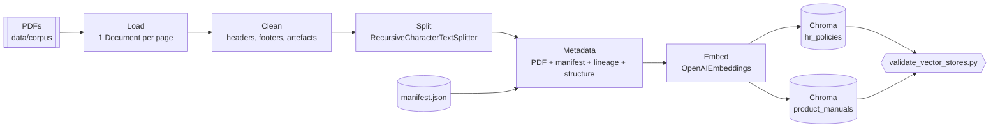
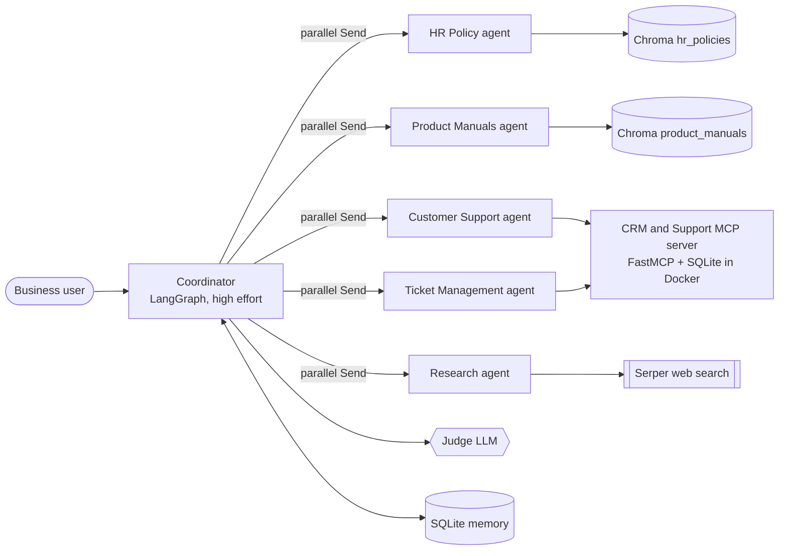

# aiml-day6: From a Synthetic RAG Corpus to a Multi-Agent Assistant

This project is a complete teaching path for Retrieval-Augmented Generation (RAG) in three stages:

1. **Corpus:** a realistic, **text-only PDF corpus** of product manuals for fictional TVs and phones and HR
   policies for a fictional Indian company, with known answers and deliberate retrieval traps.
2. **Pre-RAG:** chunking, metadata and embeddings into two persistent Chroma vector databases.
3. **Multi-agent RAG:**
   - A **LangGraph Coordinator** plans and dispatches **five specialist Deep Agents** in parallel.
   - The agents answer with hybrid, advanced, multi-query and corrective RAG, the web, and a **CRM & Support MCP
     server**.
   - A **judge LLM** gates every answer.
   - Short-term and long-term memory, plus human-in-the-loop approvals.
   - See [Multi-agent RAG](#multi-agent-rag-coordinator-and-specialist-deep-agents).

| Category | Documents | Pages each | Contents |
|---|---|---|---|
| Product manuals | 15 (8 TVs, 7 phones) | 5 to 10 | Safety, setup, features, settings, troubleshooting, error codes, specifications, warranty |
| HR policies | 15 (13 current, 2 superseded) | 3 to 4 | Document control, purpose, scope, rules, entitlement tables, procedure, FAQs, revision history |
| Golden Q&A | About 210 questions | n/a | Answer, question type, source document, page numbers and evidence strings |

Every brand, company, product and contact detail is **fictional**. An LLM has never seen this data, so a correct
answer must come from retrieval, not from the model's memory.

## Quick start

```bash
uv sync                                                              # create .venv and install dependencies
uv run scripts/corpus_data_generator.py generate --mode template     # offline, about 5 seconds
uv run scripts/corpus_data_generator.py verify                       # integrity checks
```

Or, with `make`:

```bash
make setup
make generate-template
make verify
```

The output goes to `data/`:

```
data/
  corpus/
    product_manuals/tv/*.pdf
    product_manuals/mobile/*.pdf
    hr_policies/*.pdf
    manifest.json              # metadata per document (use it for metadata filtering)
    generation_report.json     # mode, LLM statistics, guard rejections
  golden_qa/
    golden_qa.jsonl            # evaluation set (nested sources)
    golden_qa.csv              # same set, flattened for spreadsheets
  cache/llm/                   # cached LLM prose (hybrid mode)
  vectorstores/                # Chroma databases: hr_policies/, product_manuals/
```

## Generation modes

| Mode | What happens | Needs |
|---|---|---|
| `template` | Deterministic prose from Python templates. Identical output on every run. | Nothing |
| `hybrid` (default when a key is present) | Template prose is rewritten by an OpenAI model into richer, more natural text. Tables, specifications and policy rules always come from the catalog. | `OPENAI_API_KEY` in `.env` |

Hybrid mode reads these settings from `.env`:

```dotenv
OPENAI_API_KEY=sk-...
OPENAI_MODEL=gpt-5.1
OPENAI_REASONING_EFFORT=high      # none | low | medium | high
```

How hybrid mode keeps answers trustworthy:

1. **Facts never come from the LLM.** Only paragraphs marked as prose are sent to the model, together with the
   section's facts.
2. **Guard rails.** A rewrite is rejected if it adds a number that isn't in the facts, mentions a sibling model,
   or contains markdown. Rejected sections keep the template text, and every rejection is listed in
   `generation_report.json`.
3. **Cache.** Each section's output is cached in `data/cache/llm/<doc_id>/<section_id>.json`, keyed by model,
   instructions and prompt. Re-runs make **no API calls**, and the output stays stable for the golden Q&A.
   Reasoning effort is not part of the key, so changing `--effort` reuses the cached prose. Use `--refresh` to
   regenerate.
4. **Page fitting.** If the longer prose pushes a document past its page range, the renderer switches to a more
   compact layout.

### Speed: choosing a reasoning effort

A full hybrid run sends about 320 short requests (about 250 for manuals, about 75 for HR). The reasoning effort
decides how long that takes. These figures were measured with `gpt-5.1` on 2026-10-19:

| Effort | Median time per request | Full corpus, 6 workers | Command |
|---|---|---|---|
| `none` | 2.7 s | about 3 min | `make generate EFFORT=none` |
| `low` | 3.4 s | about 3 min (about 2 min with 10 workers) | `make generate-fast` |
| `medium` | 18.4 s | about 15 min | `make generate EFFORT=medium` |
| `high` | 26.8 s | about 18 min (measured) | `make generate EFFORT=high` |

In the benchmark, all four levels passed the guard equally well. Higher effort gave slightly more measured
prose, but no factual gain, because facts come from the catalog anyway. **`low` is the recommended setting for
classroom use.** To make it the default, set `OPENAI_REASONING_EFFORT=low` in `.env`.

More ways to save time:
- Raise `WORKERS` (`make generate EFFORT=low WORKERS=10`). Lower it again if you hit rate limits.
- Generate one category at a time with `--only hr` or `--only products`.
- Changing the effort reuses cached prose. Only `--refresh` (`make refresh EFFORT=low`) requests sections
  again. A fully cached run takes about 7 seconds.

## CLI reference

```
uv run scripts/corpus_data_generator.py generate [--mode template|hybrid] [--only all|products|hr]
                                                 [--refresh] [--effort none|low|medium|high] [--workers N]
uv run scripts/corpus_data_generator.py verify
```

| Make target | Equivalent |
|---|---|
| `make setup` | `uv sync` |
| `make generate` | `generate` (hybrid if a key is set). Add `EFFORT=low` or `WORKERS=10` to any hybrid target |
| `make generate-fast` | `generate --mode hybrid --effort low --workers 10` |
| `make generate-template` | `generate --mode template` |
| `make generate-hr` / `make generate-products` | `generate --mode hybrid --only hr` / `--only products` |
| `make refresh` | `generate --mode hybrid --refresh` |
| `make verify` | `verify` |
| `make clean` / `make clean-cache` | Delete the generated corpus / the LLM cache |
| `make ingest` / `make ingest-reset` | Embed the PDFs into the Chroma stores / rebuild them (`STORE=hr` or `STORE=products`) |
| `make validate-stores` / `make validate-stores-offline` | Inspect the vector stores (with or without sample queries) |
| `make clean-stores` | Delete both Chroma databases |

`generate` always rebuilds `data/corpus` and `data/golden_qa` from scratch, then runs `verify`. `verify` checks:

- Every manifest entry matches a file on disk.
- There are at least 10 documents per category.
- Page counts are within range.
- No images or XObjects are present, and no fonts are embedded.
- Superseded documents carry their banner.
- Every golden-Q&A evidence string appears on its cited pages.

## Corpus inventory

### Product manuals (fictional brands)

| Doc ID | Product | Near-duplicate family |
|---|---|---|
| TV-VOL-L43 / L55 / L55P / L65P | Voltara Lumina 43, 55, 55 Pro, 65 Pro | Voltara Lumina |
| TV-LUM-Q50 / Q55 / Q55X | Lumenix QLED Q50, Q55, Q55X | Lumenix QLED |
| TV-LUM-O65 | Lumenix OLED O65 | Lumenix OLED |
| MOB-NEX-A12L / A12 / A12P | Nexora Aria 12 Lite, 12, 12 Pro | Nexora Aria 12 |
| MOB-ZEN-Z9 / Z9P / Z9U | Zentrix Z9, Z9 Plus, Z9 Ultra | Zentrix Z9 |
| MOB-ZEN-Z5 | Zentrix Z5 | Zentrix Z5 |

### HR policies (Aranya Technologies Pvt. Ltd., Bengaluru)

| Policy ID | Title | Version |
|---|---|---|
| HR-POL-001 | Leave Policy | v3.0 current, **v2.0 superseded** |
| HR-POL-002 | Travel and Expense Claims Policy | v4.0 current, **v3.0 superseded** |
| HR-POL-003 | Medical Reimbursement and Group Health Insurance | v2.1 |
| HR-POL-004 | Code of Conduct and Ethics | v5.0 |
| HR-POL-005 | Prevention of Sexual Harassment (POSH) | v3.0 |
| HR-POL-006 | Hybrid Work and Work From Home | v2.0 |
| HR-POL-007 | IT Acceptable Use and Information Security | v4.2 |
| HR-POL-008 | Data Privacy and Confidentiality (DPDP Act) | v1.1 |
| HR-POL-009 | Attendance, Working Hours and Overtime | v2.3 |
| HR-POL-010 | Performance Management and Appraisal | v3.0 |
| HR-POL-011 | Whistleblower and Grievance Redressal | v2.0 |
| HR-POL-012 | Anti-Bribery and Anti-Corruption | v2.1 |
| HR-POL-013 | Separation, Notice Period and F&F Settlement | v2.2 |

## RAG traps: a cheat-sheet for the class

| Trap | Where to find it | What it teaches |
|---|---|---|
| **Near-duplicate models** | Lumina 55 vs 55 Pro, Q55 vs Q55X, Aria 12 vs 12 Pro, Z9 vs Z9 Plus | Similar chunks compete. Use metadata filters (`model`, `family` in `manifest.json`), hybrid BM25 + vector search, or reranking. |
| **Version conflicts** | Leave v2.0 vs v3.0 (18 vs 21 EL days), Travel v3.0 vs v4.0 (per diem, mileage, claim window) | Prefer `status=current`, use `effective_date` for recency, and show the superseded value only when the question asks for it. |
| **Cross-document consistency** | The Separation policy's leave encashment (30 days) matches Leave v3.0, not v2.0 (20 days) | Multi-hop retrieval and conflict resolution. |
| **Tables** | Specification sheets, troubleshooting, error codes, leave and claim grids | Table-aware chunking. Naive splitting separates a row label from its value. |
| **Repeated boilerplate** | Safety, e-waste and support sections across manuals; page headers and footers | Deduplication and header or footer stripping before embedding. |
| **Model-specific negatives** | "This model does not support VRR" (Lumina 43/55), "does not support eSIM" (Aria 12 Lite, Z9, Z5) | Answers that depend on the absence of a feature. |
| **Unanswerable questions** | Products and policies that don't exist (Lumina 75 Pro, Aria 13, referral bonus) | Make the model abstain instead of hallucinating. |

## Golden Q&A format

Each line of `golden_qa.jsonl`:

```json
{"id": "Q0001", "question": "What is the native refresh rate of the Voltara Lumina 43?",
 "answer": "60 Hz", "category": "product_manual", "question_type": "near_duplicate", "difficulty": "medium",
 "sources": [{"doc_id": "TV-VOL-L43", "file": "product_manuals/tv/TV-VOL-L43_Voltara_Lumina_43_User_Manual.pdf",
              "pages": [7], "evidence": ["Native refresh rate", "60 Hz"]}]}
```

Question types: `factual`, `table_lookup`, `near_duplicate`, `version_conflict`, `comparison` (multi-document),
`procedural` and `unanswerable` (empty `sources`). Use `pages` to measure retrieval hit rate, and `answer` for
answer-correctness metrics (for example with RAGAS or an LLM judge).

## Pre-RAG: chunking, embeddings and two Chroma vector databases

The corpus is indexed into **two persistent Chroma databases**, following the LangChain retrieval building blocks
(document loader, text splitter, embedding model, vector store):

| Store | Source PDFs | Database folder | Default chunk size/overlap |
|---|---|---|---|
| `hr` | `data/corpus/hr_policies/` | `data/vectorstores/hr_policies/` | 800 / 120 characters |
| `products` | `data/corpus/product_manuals/` | `data/vectorstores/product_manuals/` | 1200 / 200 characters |

```bash
uv run scripts/ingest_vector_stores.py            # or: make ingest     (STORE=hr|products to pick one)
uv run scripts/validate_vector_stores.py          # or: make validate-stores
```

Embedding the whole corpus with `text-embedding-3-small` takes about 12 seconds and costs a fraction of a cent.
Re-running is **idempotent**:
- Documents whose chunks are unchanged are skipped without API calls.
- Changed documents have their old chunks replaced.
- PDFs deleted from disk are removed from the store.
- `--reset` (`make ingest-reset`) rebuilds a store from scratch.

See **[docs/architecture/pre_rag_architecture.md](docs/architecture/pre_rag_architecture.md)** for the
architecture diagrams: the components, one document's journey, and how metadata is assembled.



### Ingestion settings (`.env`)

| Key | Default | Purpose |
|---|---|---|
| `OPENAI_EMBEDDING_MODEL` | `text-embedding-3-small` | Embedding model (1536 dimensions) |
| `HR_CHUNK_SIZE` / `HR_CHUNK_OVERLAP` | 800 / 120 | Characters per chunk for HR policies |
| `PRODUCT_CHUNK_SIZE` / `PRODUCT_CHUNK_OVERLAP` | 1200 / 200 | Characters per chunk for manuals |
| `INGEST_BATCH_SIZE` | 4 | PDFs prepared **and embedded** in parallel |
| `EMBEDDING_BATCH_SIZE` | 100 | Chunks per embeddings request and per Chroma write |
| `STRIP_HEADERS_FOOTERS` | true | Remove repeated page headers and footers before chunking |
| `VECTORSTORE_DIR`, `HR_COLLECTION_NAME`, `PRODUCT_COLLECTION_NAME` | `data/vectorstores`, `hr_policies`, `product_manuals` | Where the databases live |
| `VALIDATION_SAMPLE_SIZE` | 3 | Sample records shown by the validation script |

All keys are listed in [.env.example](.env.example). A shell environment variable overrides `.env`, which is
handy for experiments, for example `HR_CHUNK_SIZE=500 uv run scripts/ingest_vector_stores.py --store hr`.

### Metadata stored on every chunk

| Group | Fields | Why it is recommended |
|---|---|---|
| Common PDF | `source`, `file_name`, `file_size_bytes`, `page` (0-based), `page_number` (1-based), `total_pages`, `pdf_title`, `pdf_author`, `pdf_subject`, `pdf_keywords`, `pdf_creator` | Citations ("see page 4 of ..."). Works for any PDF, not just this corpus. |
| Corpus manifest | `doc_id`, `category`, `subcategory`, `title`, `publisher`, `brand`, `model`, `model_number`, `family`, `version`, `status`, `effective_date`, `supersedes`, `superseded_by` | **Metadata filtering**: `status="current"` defeats the version trap, `model="Lumina 55 Pro"` defeats near-duplicates, and `category` routes questions to a store. |
| Chunk lineage | `chunk_id` (`DOC:p002:c03`), `chunk_index`, `chunk_index_in_doc`, `chunks_in_doc`, `start_index`, `char_count`, `token_count`, `content_hash` | Deterministic IDs make re-ingestion idempotent. The hash detects unchanged content. Positions allow neighbouring-chunk expansion. Token counts support context budgeting. |
| Structure hints | `section_title` (from the PDF outline), `content_type` (`table`, `list` or `prose`) | Section-aware answers and citations. Shows why table chunks retrieve differently from prose. |

The collection metadata of each database also records the embedding model, dimensions, distance (cosine),
chunk settings, pipeline version and ingestion time, so each database describes how it was built.

**Further metadata to consider** in a production system: `language`; `access_level` or `audience`
(confidentiality, for permission-aware retrieval); `region` or `jurisdiction`; `product_line`, `release_year`
and `os_version`; `expiry_date` or `review_due`; `checksum` of the source file; `ingested_by`; and
LLM-generated `summary`, `keywords` or `questions_answered` (for hypothetical-question indexing).

### What the sample queries already reveal

The validation script's sample queries show the corpus traps in action:
- **Version conflict.** The top hit for the Tier X per-diem query comes from the *superseded* Travel Policy
  v3.0, so filter on `status`.
- **Near duplicates.** "Lumina 55 Pro refresh rate" also returns the Lumina 43 specification table, so filter
  on `model`.
- **Exact codes.** "What does error code E-715 mean?" is weak for dense embeddings, which motivates hybrid
  BM25 + vector search.

## Multi-agent RAG: Coordinator and specialist Deep Agents

Instead of one bloated agent with every tool, a **Coordinator** built with LangGraph thinks hard (high reasoning
effort). It plans the work, dispatches **specialists** in parallel, reflects on their reports and writes the answer.
A separate **judge LLM** grades the answer before it reaches the user.



Full diagrams (graph, sequences, approval flow, pipelines, skills) are in
[docs/architecture/multi_agent_architecture.md](docs/architecture/multi_agent_architecture.md).

### Quick start

```bash
uv sync                      # dependencies (includes deepagents, langgraph, langchain[mcp], rank-bm25)
make generate-template       # corpus (or a hybrid generate), then:
make ingest                  # two Chroma stores
make mcp-server-up           # CRM & Support MCP server in Docker on http://localhost:8765/mcp
make mcp-server-status       # {"status": "ok", "customers": 40, "tickets": 120}
```

Then open the notebooks in `notebooks/` with the project's `.venv` kernel. In Python:

```python
from agentic_rag.graph import CoordinatorService

async with CoordinatorService.open() as service:
    result = await service.ask("How many casual leave days do I get per year?", user_id="emp-42", on_event=print)
    if result.status == "needs_approval":            # ticket writes wait for a human
        result = await service.resume(result.thread_id, "approve")
    print(result.answer)
```

### The team

| Agent | Tools | Skills | Notes |
|---|---|---|---|
| **Coordinator** (LangGraph) | plans and dispatches agents; holds the MCP write tools | `coordination` | Plan, clarify, reflect, approve, synthesize, judge loop, long-term memory |
| HR Policy | `hybrid_search`, `advanced_search`, `multi_query_search`, `corrective_search` on `hr` | `hr-policies`, `rag-answering` | Current policy version by default |
| Product Manuals | same four tools on `products` | `product-support`, `rag-answering` | Always pins the exact model |
| Customer Support | MCP `get_customer_profile`, `search_customer_profiles` | `customer-support` | Read-only |
| Ticket Management | MCP `get_tickets_by_customer`, `search_tickets` | `ticket-management` | **Proposes** writes; never executes them |
| Research | `web_search` (Serper) | `web-research` | Current, external information only |

Each specialist is a Deep Agent (`create_deep_agent`):
- It has only its own tools.
- It has its own skills, mounted read-only.
- It returns a structured **`AgentReport`**: findings, evidence with verbatim quotes, confidence, gaps and
  proposed actions.

### RAG patterns

| Pattern | Where | What it does |
|---|---|---|
| Hybrid | `rag/hybrid_rag.py` | Metadata filter (model, document, version) + vector + BM25, fused with Reciprocal Rank Fusion |
| Advanced | `rag/advanced.py` | LLM query rewrite, current versions only, 20 candidates, LLM rerank, token-budgeted context in reading order |
| Multi-query | `rag/multi_query.py` | Splits a compound question, searches each part in parallel, fuses and keeps the top hits of every part |
| Corrective | `rag/corrective.py` | Grades evidence; broadens, then switches store; says "I don't know"; checks the answer statement by statement |
| Agentic | `graph/` | The Coordinator decides whether, where and when to search again (plan, reflect, replan, judge retry) |

### Quality gate, interrupts and memory

- **Judge.** `JUDGE_OPENAI_MODEL` (with `JUDGE_OPENAI_API_KEY`) scores four criteria:
  - context relevance
  - groundedness
  - answer relevance
  - completeness

  Below `JUDGE_PASS_SCORE` (80), the critique goes back to the planner, which redoes only the weak parts. After
  `JUDGE_MAX_RETRIES` (3), the best attempt is returned with a **low-confidence** notice.
- **Interrupts.** The graph pauses for a **clarifying question** when the answer depends on facts nobody can look
  up. It also pauses for **approval** of proposed ticket writes: approve, reject, or edit the arguments. The thread
  resumes from its SQLite checkpoint, even after a restart.
- **Memory.**
  - *Short-term:* the conversation per `thread_id`, so follow-ups work.
  - *Long-term:* facts per `user_id`, owned by the Coordinator, such as customer ID and products owned. These are
    recalled on new threads.

### CRM & Support MCP server

`src/mcp_servers/crm_support` is a **FastMCP** server. It uses streamable HTTP at `/mcp` and a SQLite database
(`CRM_DB_PATH`), seeded with 40 fictional customers and 120 tickets that reference the corpus models and error codes.

| Kind | Items |
|---|---|
| Tools (read-only) | `get_customer_profile`, `search_customer_profiles`, `get_tickets_by_customer`, `search_tickets` (case-insensitive partial matching, paging) |
| Tools (write) | `register_ticket`, `resolve_ticket` (no customer create, update or delete) |
| Resources | `crm://customers/{id}`, `crm://customers/{id}/tickets`, `tickets://{id}`, `crm://schema`, `tickets://stats` |
| Prompts | `triage_ticket(ticket_id)`, `customer_360_summary(customer_id)` |
| Business rules | Inactive customers cannot raise tickets; only `open`/`in_progress` tickets can be resolved, and that needs `resolved_by` and remarks; enum validation; duplicate guard (similar open title) |

Packaging:
- A multi-stage, slim, non-root image (`Dockerfile`; no HEALTHCHECK by design) built with
  `docker-compose.yml`.
- The port is published on **127.0.0.1 only**, because the server has **no authentication** (see
  [SECURITY.md](SECURITY.md)).
- The startup banner (`make mcp-server-logs`) shows the endpoint, database, record counts and capabilities.

| Make target | Purpose |
|---|---|
| `make mcp-server-up` / `mcp-server-down` | Build and start, or stop, the container (data in `data/crm/` persists) |
| `make mcp-server-status` / `mcp-server-logs` | `/health` check / follow the coloured logs |
| `make mcp-seed-reset` | Restore the demo data (removes tickets created in class) |
| `make crm-seed` | Regenerate the seed JSON from the corpus catalogue |

Any MCP client can use the server, for example a VS Code `mcp.json` entry with
`{"type": "http", "url": "http://localhost:8765/mcp"}`.

### Skills: one source, reused by Claude Code, Codex and Copilot

`src/skills/` holds seven [Agent Skills](https://agentskills.io): `SKILL.md` with `name` and `description`
frontmatter, plus optional scripts. The specialists load them through a read-only Deep Agents backend.
`make sync-skills` copies them to the folders each coding assistant discovers.

| Tool | Discovers skills in |
|---|---|
| Claude Code | `.claude/skills/` |
| OpenAI Codex | `.agents/skills/` |
| GitHub Copilot (VS Code / CLI / coding agent) | `.github/skills/`, `.claude/skills/` or `.agents/skills/` |

**Recommendation:**
- **Edit only `src/skills/`.** Run `make sync-skills` and commit the mirrors.
- **Add `make check-skills` to CI or a pre-commit hook.** It fails on drift or invalid frontmatter.
- **Do not add a third copy for Copilot.** Copilot already reads both mirrors.

Copies are used instead of symlinks because symlinks need extra privileges on Windows.
`hr-policies` and `product-support` include `scripts/search.py`, so a coding assistant can run the same RAG
pipelines from the shell:

```bash
uv run python .claude/skills/product-support/scripts/search.py "E-715" --model "Lumina 55 Pro" --pipeline hybrid
```

### Scenario notebooks

The notebooks contain use cases and code only. Run them to see the outputs.

| Notebook | Scenario |
|---|---|
| `01_hr_policy_question` | Hybrid vs advanced RAG, the version trap, the judge, the graph |
| `02_product_troubleshooting` | Model pinning, BM25 vs vectors for `E-715`, RRF, corrective RAG, a specialist report |
| `03_customer_complaint_end_to_end` | Customer, then manual + tickets, then a proposed ticket, **approval**, and the ticket created via MCP |
| `04_ticket_resolution_workflow` | Ticket search, then manual guidance, then `resolve_ticket` approved **with an edit** |
| `05_mixed_multi_domain_question` | HR + product + tickets in one question, with **parallel** dispatch and a timeline |
| `06_current_trends_question` | Research agent (Serper) next to the product catalogue |
| `07_ambiguous_question_clarification` | Clarifying **interrupt**, then resume |
| `08_follow_ups_and_memory` | Follow-ups on a thread; long-term facts recalled on a new thread |
| `09_judge_retry_and_low_confidence` | Honest "I don't know"; forced retries and the low-confidence fallback |
| `10_support_dashboard_mcp` | Raw MCP client: tools, resources, prompts, business-rule errors |
| `11_context_engineering` | Token budgets, specialist context isolation, Coordinator digests |
| `12_rag_patterns_evaluation` | Batch evaluation of the four pipelines and the graph |

### Evaluation

`make evaluate SAMPLE=10` runs a stratified sample of the golden Q&A through every pipeline and prints these metrics
per pipeline:
- `hit_rate` and `mrr`
- `golden_match` (key facts of the golden answer appear in the answer)
- judge mean and pass rate
- latency

Add `GRAPH=1` to include the full graph. `make evaluate-fast` skips the judge. Reports are written to `data/eval/`.

### Settings (`.env`)

| Key | Default | Purpose |
|---|---|---|
| `COORDINATOR_REASONING_EFFORT` | `high` | Coordinator plan, reflect and synthesize (`OPENAI_MODEL`) |
| `OPENAI_FAST_MODEL`, `OPENAI_FAST_REASONING_EFFORT` | `gpt-5.1`, `low` | RAG steps, memory extraction; also the specialists' model |
| `SPECIALIST_REASONING_EFFORT` | `low` | Specialist Deep Agents |
| `MAX_REPLANS`, `MAX_AGENT_CALLS` | `2`, `8` | Graph budgets per question |
| `JUDGE_OPENAI_MODEL`, `JUDGE_OPENAI_API_KEY`, `JUDGE_REASONING_EFFORT` | `gpt-5.5`, -, `low` | Judge model and key |
| `JUDGE_PASS_SCORE`, `JUDGE_MAX_RETRIES` | `80`, `3` | Pass mark (0-100) and retries |
| `RAG_TOP_K`, `RAG_CANDIDATE_K`, `RRF_K` | `6`, `20`, `60` | Context size, candidates per retriever, RRF constant |
| `SERPER_API_KEY`, `SERPER_RESULTS` | -, `5` | Research agent |
| `AGENT_STATE_DIR` | `data/agent_state` | SQLite checkpointer and long-term store |
| `MCP_CONFIG_PATH`, `CRM_MCP_URL` | `config/mcp_servers.json`, `http://localhost:8765/mcp` | MCP servers used by the agents |
| `CRM_DB_PATH`, `MCP_PORT`, `CRM_SEED_ON_START`, `MCP_LOG_LEVEL` | `data/crm/crm_support.db`, `8765`, `true`, `warning` | MCP server |
| `EVAL_SAMPLE_SIZE` | `20` | Golden questions per evaluation |

## Project structure

```
scripts/corpus_data_generator.py   orchestrator only: parse args, call helpers, print summary
src/data_generation/
  config.py           Settings from .env and project paths
  models.py           Document model: Document, Section, Paragraph, Bullets, Table, Notice
  catalog/            every fact: products.py (brands, TVs, phones), hr_policies.py (company, 15 policies)
  builders/           facts -> Document with template prose (tv_manual, phone_manual, hr_policy)
  llm/                client (Responses API), cache, guard, enricher
  rendering/          ReportLab PDF renderer with page fitting
  qa/                 golden Q&A builder and PDF page-text lookup
  manifest.py         data/corpus/manifest.json
  verify.py           integrity checks

scripts/ingest_vector_stores.py    orchestrator: PDFs -> chunks -> embeddings -> two Chroma databases
scripts/validate_vector_stores.py  orchestrator: summary, stats, samples, manifest cross-check, sample queries
src/data_ingestion/
  config.py           .env settings and the two store definitions (hr, products)
  loading.py          one LangChain Document per PDF page + common PDF metadata + outline headings
  cleaning.py         extraction repair, repeated header/footer removal
  structure.py        section_title (PDF outline) and content_type heuristics
  chunking.py         RecursiveCharacterTextSplitter, page-level, add_start_index
  metadata.py         manifest lookup, chunk lineage, deterministic IDs, Chroma-safe values
  embeddings.py       OpenAIEmbeddings (OPENAI_EMBEDDING_MODEL, EMBEDDING_BATCH_SIZE)
  vectorstore.py      persistent Chroma collections: open, reset, upsert, collection metadata
  pipeline.py         parallel prepare + embed (INGEST_BATCH_SIZE), change detection, per-document replace
  validation.py       read-only summaries, cross-checks and sample queries
docs/architecture/pre_rag_architecture.md   Mermaid architecture diagrams

src/agentic_rag/                   multi-agent RAG
  config.py           AgentSettings (models, efforts, judge, budgets, paths) from .env
  llm.py              coordinator / specialist / fast / judge chat models (Responses API + reasoning effort)
  retrieval/          stores, metadata filters (model, version), vector + MMR, BM25, hybrid RRF
  rag/                steps (rewrite, decompose, grade, rerank, groundedness), context, answer,
                      pipelines: hybrid_rag, advanced, multi_query, corrective
  web/serper.py       Serper web and news search
  agents/             AgentReport contract, Deep Agent builder, RAG tools, the five specialists, registry
  graph/              state, prompts, nodes (plan ... save_memory), builder (+ Mermaid), service (ask/resume)
  evaluation/         judge (scores, weighted overall), batch evaluation on the golden set
  memory.py           AsyncSqliteSaver (thread) + AsyncSqliteStore (user facts)
  mcp_client.py       MCP tool discovery and grouping (customer / ticket read / ticket write)
  skills_sync.py      skill validation and mirroring
src/mcp_servers/crm_support/       FastMCP server: config, models, db, rules, tools, resources, prompts,
                                   seed (+ seed/seed_data.json), banner, server
src/skills/                        7 Agent Skills (source of truth); mirrored to .claude/skills and .agents/skills
config/mcp_servers.json            MCP servers used by the agents (${CRM_MCP_URL})
notebooks/                         12 scenario notebooks (no outputs)
scripts/sync_skills.py             sync | check
scripts/evaluate_rag.py            sampled batch evaluation
scripts/export_graph_diagram.py    Mermaid export of the compiled graph
scripts/build_crm_seed.py          CRM seed JSON from the corpus catalogue
Dockerfile, docker-compose.yml, .dockerignore   CRM & Support MCP server image (multi-stage, slim, non-root)
docs/architecture/multi_agent_architecture.md   multi-agent diagrams and design notes
```

**To add a product**, append a dict to `TVS` or `PHONES` in `catalog/products.py`, copying an existing entry.
**To add a policy**, add a dict to `POLICIES` in `catalog/hr_policies.py`, including its `qa` list. In both
cases, re-run `generate`, and `verify` confirms that the new evidence strings appear in the PDFs.

## Disclaimer

This is synthetic teaching material. Brands, companies, people, prices, phone numbers and `.example` web
addresses are fictional. References to Indian statutes (for example the Maternity Benefit Act, the POSH Act,
the DPDP Act and the Labour Codes) are illustrative, simplified and **not legal advice**.

## Further reading

[TROUBLESHOOTING.md](TROUBLESHOOTING.md) · [SECURITY.md](SECURITY.md) · [CHANGELOG.md](CHANGELOG.md) ·
[CODE_OF_CONDUCT.md](CODE_OF_CONDUCT.md) · [LICENSE](LICENSE) (MIT)
