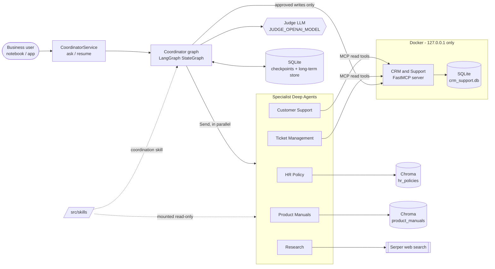
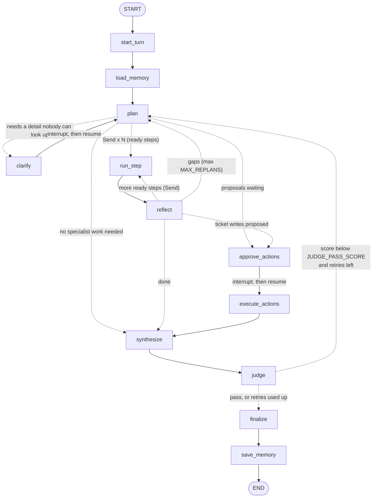
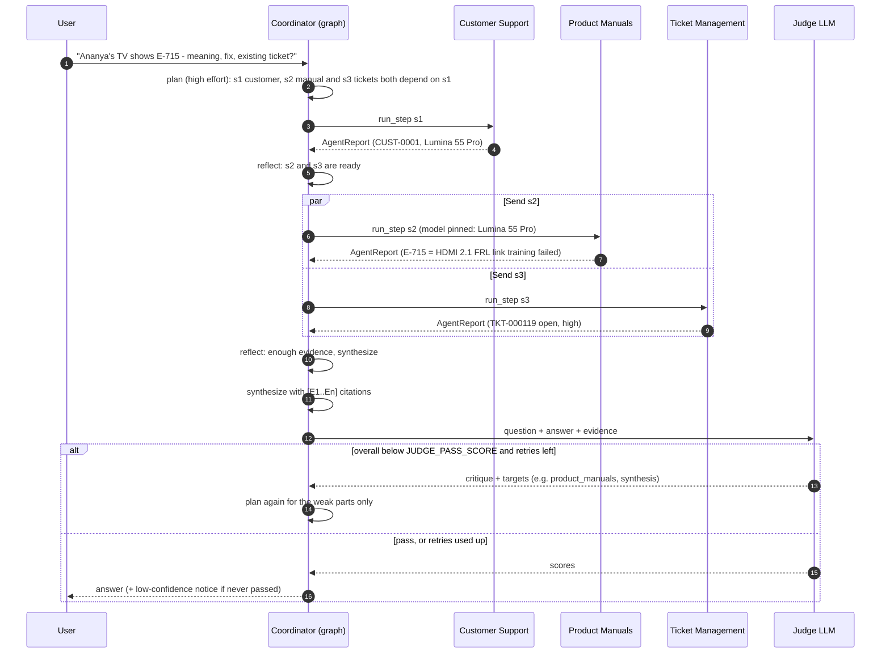
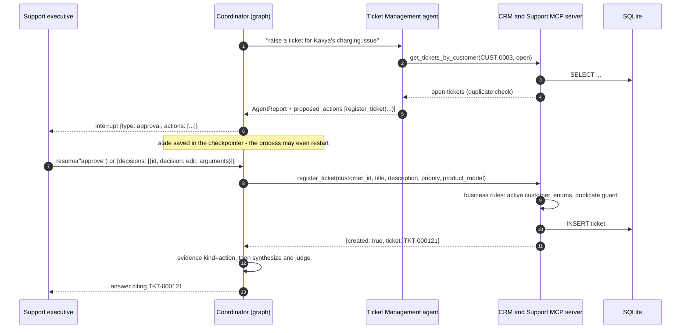
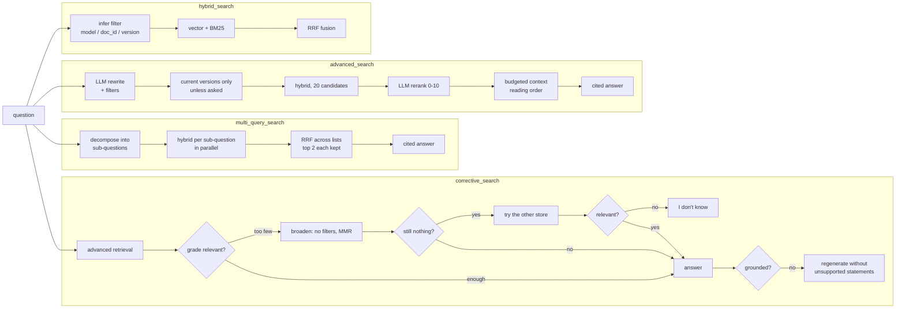
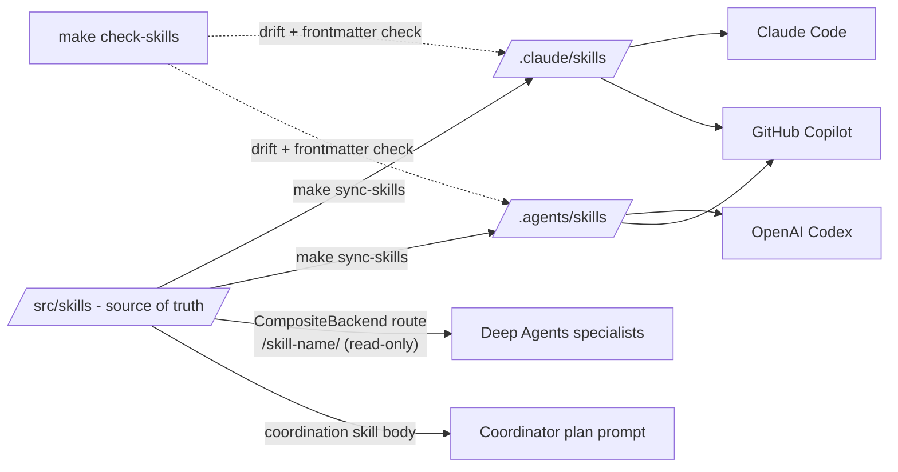

# Multi-Agent RAG Architecture

This document explains how the multi-agent assistant answers a business question. It builds on the Pre-RAG
stores described in [pre_rag_architecture.md](pre_rag_architecture.md).

- A **LangGraph Coordinator** plans the work and dispatches **five specialist Deep Agents** in parallel.
- It reflects on their reports and writes the answer.
- A **judge LLM** gates the answer.
- Customer and ticket data come from a **FastMCP server** running in Docker.

## 1. System context

| Component | Technology | Responsibility |
|---|---|---|
| Coordinator | LangGraph `StateGraph`, `OPENAI_MODEL` at `COORDINATOR_REASONING_EFFORT=high` | Plan, clarify, dispatch, reflect, approval, synthesis, judge loop, memory |
| Specialists | Deep Agents `create_deep_agent`, `SPECIALIST_REASONING_EFFORT=low` | Do one well-scoped task with their own tools and skills; return an `AgentReport` |
| RAG tools | `src/agentic_rag/rag` | Hybrid, advanced, multi-query and corrective pipelines over the two Chroma stores |
| CRM & Support | FastMCP 4 (streamable HTTP), SQLite, Docker | Customer profiles, tickets, resources, prompts and business rules |
| Judge | `JUDGE_OPENAI_MODEL` with its own key | Scores the final answer; below `JUDGE_PASS_SCORE` triggers a targeted retry |
| Memory | `AsyncSqliteSaver` and `AsyncSqliteStore` | Thread state (follow-ups, interrupts) and per-user facts |

## 2. The Coordinator graph

The diagram below is generated from the compiled graph by `make graph-diagram`
([coordinator_graph.mmd](../diagrams/coordinator_graph.mmd)). Dotted edges are conditional.

| Node | Model | What it does |
|---|---|---|
| `start_turn` | none | Reads the question from the last message and resets per-turn fields; keeps a short conversation window |
| `load_memory` | none | Recalls the user's long-term facts from the store |
| `plan` | coordinator (high) | Returns a structured `Plan` (steps with agent, goal, `depends_on`, success criteria) or a clarifying question; on replans and retries it targets only the gaps or the judge's critique |
| `clarify` | none | `interrupt()` with the question; the user's answer resumes the thread |
| `run_step` | specialist (low) | Runs one specialist; parallel branches append reports through an accumulate reducer |
| `reflect` | coordinator (high) | Continues with dependent steps, replans for important gaps, or moves on |
| `approve_actions` | none | `interrupt()` listing proposed ticket writes; approve, reject or edit each one |
| `execute_actions` | none | Calls the MCP `register_ticket` / `resolve_ticket` tools; results become evidence |
| `synthesize` | coordinator (high) | Writes the answer from reports and numbered evidence `[E#]` |
| `judge` | judge | Scores 4 criteria and the weighted overall; stores the critique and targets |
| `finalize` | none | Picks the passing (or best) attempt; adds a low-confidence notice if none passed |
| `save_memory` | fast | Extracts durable user facts and stores them under `("users", user_id, "facts")` |

**Budgets:**
- `MAX_AGENT_CALLS` caps specialist runs per question.
- `MAX_REPLANS` caps reflection replans per attempt.
- `JUDGE_MAX_RETRIES` caps judge-driven retries.
- Up to two clarifying questions per turn.

## 3. Plan, parallel dispatch, reflect and the judge loop

## 4. Ticket writes: propose, approve, execute

The Ticket Management agent has **only read tools**. Write tools stay in the graph, so no write happens without a
human decision, and an interrupt never fires inside a parallel specialist.

## 5. RAG pipelines (tools of the HR Policy and Product Manuals agents)

| Pipeline | LLM calls | Best for |
|---|---|---|
| `hybrid_search` | 0 (retrieval only) | Error codes, model numbers, policy IDs, fast lookups |
| `advanced_search` | rewrite, rerank, answer | Most questions; version-aware |
| `multi_query_search` | decompose, answer | Compound questions |
| `corrective_search` | rewrite, rerank, grade (1-3), answer, groundedness (1-2) | Unsure coverage; must not guess |

## 6. Skills: one source, three consumers

| Skill | Used by | Contents |
|---|---|---|
| `hr-policies` | HR Policy agent | Tool choice, version rules, policy catalogue; `scripts/search.py` |
| `product-support` | Product Manuals agent | Model pinning, model table, error-code handling; `scripts/search.py` |
| `rag-answering` | HR and Product agents | Search discipline, evidence quotes, "I don't know", confidence |
| `customer-support` | Customer Support agent | Identity resolution, what to report, inactive customers |
| `ticket-management` | Ticket Management agent | Server rules, duplicate guard, priority guide, proposing writes |
| `web-research` | Research agent | When to search, source quality, URL and date evidence |
| `coordination` | Coordinator (plan prompt) | Ownership table, planning, clarification and replanning rules |

## 7. Memory and state

| Kind | Where | Key | Lifetime | Used for |
|---|---|---|---|---|
| Short-term | `data/agent_state/checkpoints.sqlite` | `thread_id` | Per conversation | Follow-ups, clarification and approval interrupts, resuming after a restart |
| Long-term | `data/agent_state/long_term_memory.sqlite` | `("users", user_id, "facts")` | Across conversations | Customer ID, products owned, preferences, tickets raised |
| Specialist | in-memory Deep Agent state | per run | One step | Tool outputs and scratch files, isolated from the Coordinator |

`make clean-agent-state` deletes both SQLite files, and `service.forget(user_id)` deletes one user's facts.

## 8. Context engineering

- **Isolation:** each specialist reads raw tool output. The Coordinator sees only compact reports (findings,
  evidence quotes, confidence and gaps), usually a few hundred tokens instead of thousands.
- **Budgets:** `build_context` keeps the most relevant chunks within a token budget, then orders them for
  reading (document, page, position).
- **Compression:** Coordinator prompts use digests, the last six conversation messages (truncated) and one-line
  long-term facts. Deep Agents summarise long specialist histories automatically.

Notebook 11 measures all three.
