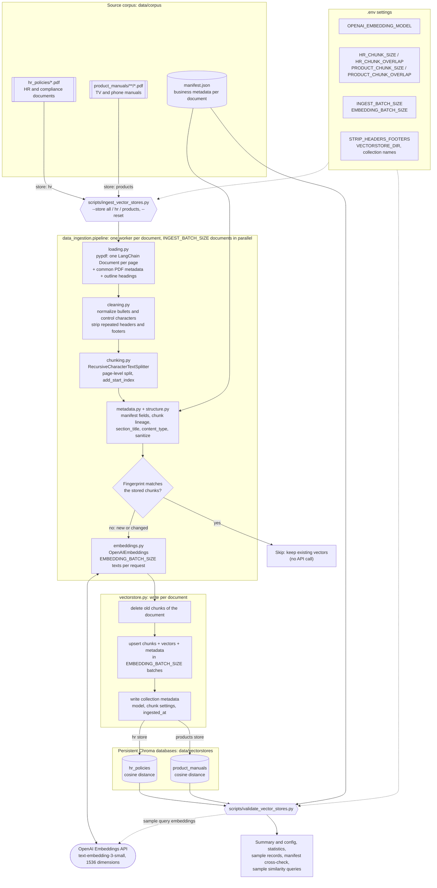
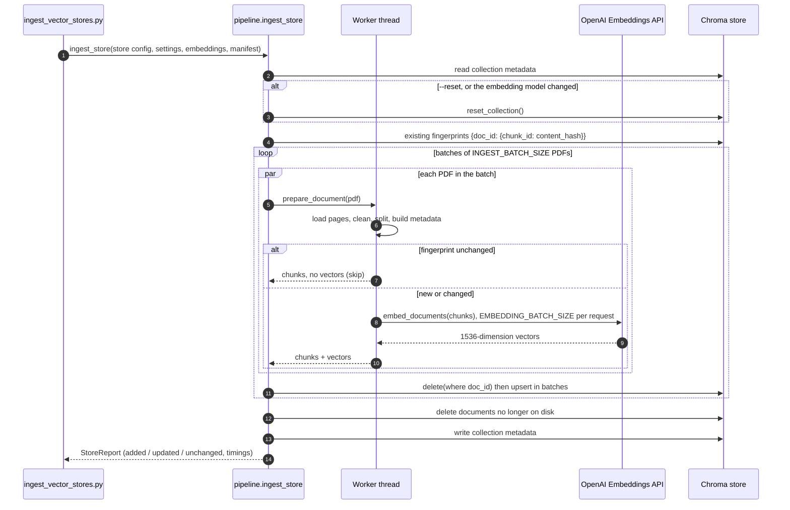
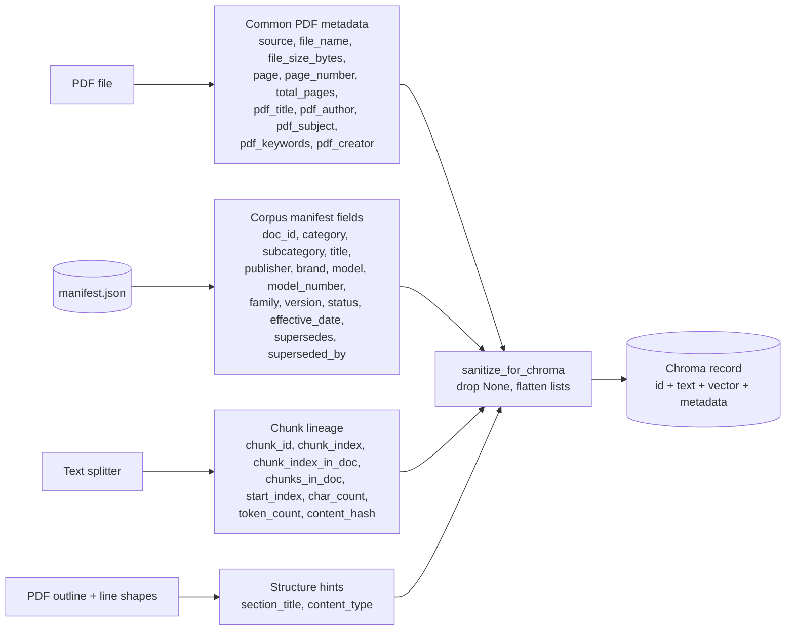

# Pre-RAG Architecture: from PDFs to Two Chroma Vector Databases

This document describes how the pre-RAG components in `src/data_ingestion/` work together to turn the
generated PDF corpus into two persistent Chroma vector databases:
- `hr_policies` holds HR and compliance documents.
- `product_manuals` holds product manuals and guides.

The pipeline follows the LangChain retrieval building blocks: document loader, text splitter, embedding
model and vector store.

## 1. Component architecture

## 2. One document's journey (and why re-runs are cheap)

## 3. How a chunk's metadata is assembled

## Component responsibilities

| Component | File | Responsibility |
|---|---|---|
| Configuration | `src/data_ingestion/config.py` | Reads `.env`, defines the `hr` and `products` stores |
| Loader | `src/data_ingestion/loading.py` | One `Document` per page, common PDF metadata, outline headings |
| Cleaning | `src/data_ingestion/cleaning.py` | Repairs extraction artefacts; strips repeated headers and footers |
| Structure | `src/data_ingestion/structure.py` | `section_title` from the outline, `content_type` heuristic |
| Splitter | `src/data_ingestion/chunking.py` | `RecursiveCharacterTextSplitter`, page-level, `add_start_index` |
| Metadata | `src/data_ingestion/metadata.py` | Manifest lookup, chunk lineage, deterministic IDs, Chroma-safe values |
| Embeddings | `src/data_ingestion/embeddings.py` | `OpenAIEmbeddings` with `EMBEDDING_BATCH_SIZE` per request |
| Vector store | `src/data_ingestion/vectorstore.py` | Opens, resets and writes the persistent Chroma collections |
| Pipeline | `src/data_ingestion/pipeline.py` | Parallel prepare-and-embed, change detection, per-document replace |
| Validation | `src/data_ingestion/validation.py` | Read-only summaries, cross-checks and sample queries |
| Orchestrators | `scripts/ingest_vector_stores.py`, `scripts/validate_vector_stores.py` | CLI entry points that only coordinate and print |
