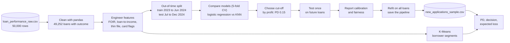

# Northwind Finance: Loan Default Risk

**A classification use case with a 50,000-row dataset**
**Scenario:** Northwind Finance (a fictional Indian retail lender) wants to know, at the moment someone applies, **how likely they are to default** on the loan, and to use that probability to approve, refer or decline, to set the cut-off that makes the most money, and to forecast credit losses honestly.
**Companion to:** the Northwind Finance *Loan Offer* regression demo. That demo answered *"how much can we lend?"*; this one answers *"will they pay it back?"*
**Data:** `loan_performance_raw.csv` (50,000 rows, synthetic, with planted quality problems) and `new_applications_sample.csv` (10 rows to score).

> **Fictional and synthetic.** Northwind Finance, its customers and every number here are invented for training. The data was generated with a fixed random seed, so everyone gets the same results.

---

## 1. The business

Northwind Finance lends to individuals across 22 Indian cities: home, personal, auto, education, business and consumer-durable loans. Applications arrive through branches, the mobile app and website, direct-selling agents (DSAs) and retail partner merchants.

Over 2023 and 2024 it disbursed **49,400 loans**. About **one in ten defaulted** within a year. That's far above the risk team's appetite, and every default costs roughly half of the loan once recoveries are counted.

Today, approval is driven by a few hand-written rules: a minimum credit score, a cap on existing EMIs, and an underwriter's judgement. The rules are simple to explain but blunt. They reject some good customers, approve some bad ones, and can't say *how* risky an applicant is. That means the business can't price for risk or forecast losses.

### People in the story

| Persona | Role | What they need |
|---|---|---|
| **Kavita Rao**, Chief Risk Officer | Sponsor. Owns the credit-loss budget. | Fewer defaults without strangling growth; a loss forecast she can defend |
| **Arjun Mehta**, Head of Retail Lending | Owns disbursal targets | A high approval rate and fast decisions |
| **Underwriting team** | Reviews borderline files | A clear "approve / refer" signal with reasons |
| **Finance** | Sets aside provisions for expected losses | Probabilities that mean what they say |
| **Compliance** | Fair lending, explainability | Proof that the model treats groups fairly and can explain each decision |
| **The data scientist** (participants) | Builds the model | Clean data, an honest evaluation, a deployable pipeline |

Arjun and Kavita pull in opposite directions. Arjun wants more approvals; Kavita wants fewer defaults. The model's job is to give them a shared, numeric way to agree where the line goes.

---

## 2. Why this is a classification problem

| | Loan Offer demo (regression) | This use case (classification) |
|---|---|---|
| **Question** | How much can we lend this applicant? | Will this borrower default within 12 months? |
| **Target** | `max_loan_offered`, in rupees | `defaulted_12m`, Yes or No |
| **Model output** | A number | A **probability of default (PD)**, then a decision |
| **Typical algorithm** | Linear regression | **Logistic regression** (plus KNN for comparison, K-Means for segments) |
| **Success measured by** | MAE, RMSE, R² | Confusion matrix, precision and recall, ROC AUC, PR AUC, calibration, **profit** |
| **Key business decision** | Cap the offer by policy rules | **Choose the cut-off**: approve below it, refer or decline above it |

The model doesn't make the decision on its own. It produces a probability, and the business chooses a **threshold** that balances lost good customers against avoided defaults. That separation is the heart of this use case.

---

## 3. The six business questions

Kavita's brief to the data team:

> 1. **What actually predicts default?** Which signals matter, and by how much?
> 2. **Which algorithm should we trust?** And is it fair to compare them?
> 3. **How good is the model, in terms the business understands?** How many defaulters would it stop, and how many good customers would it turn away?
> 4. **Where should the cut-off be?** I want the line that makes us the most money, and Arjun wants to know what it does to the approval rate.
> 5. **Can Finance use the probabilities for provisioning?** If the model says 10%, do 10% default?
> 6. **Is it fair?** Show me it doesn't penalise anyone for their gender, and tell me what it does to young borrowers.

There is also a seventh question, for the segmentation part: **what kinds of borrowers do we have**, and does each need a different policy?

---

## 4. The data

### Files

| File | Rows | What it is |
|---|---|---|
| `data/loan_performance_raw.csv` | **50,000** (49,400 loans + 600 duplicate rows) | One row per disbursed loan, Jan 2023 to Dec 2024, as extracted from the loan system and the credit bureau, **with planted quality problems** |
| `data/new_applications_sample.csv` | 10 | Brand-new March 2025 applications, clean, no outcome. Used to demonstrate scoring. None of them appear in the training file. |

### Data dictionary

"Known at application?" is the most important column in this table. A feature is only usable if it exists at the moment the decision is made.

| Column | Meaning | Known at application? |
|---|---|---|
| `loan_id` | Loan identifier (`NWL-000001` …) | Identifier, not a feature |
| `disbursal_date` | Date the loan was paid out | Used to split by time, not as a feature |
| `age` | Applicant age in years | Yes (see fairness) |
| `gender` | Male / Female / Other | Yes, but **excluded**: kept only for fairness checks |
| `marital_status`, `dependents` | Family situation | Yes; marital status excluded as sensitive |
| `education` | Highest qualification | Yes |
| `city` | One of 22 cities (tiers 1–3) | Yes |
| `residence_type` | Owned / Rented / Family | Yes |
| `employment_type` | Salaried / Self-Employed / Business Owner | Yes |
| `years_employed` | Years in current work | Yes |
| `annual_income` | Declared annual income, INR | Yes |
| `credit_score` | Bureau score 300–900; **blank for new-to-credit applicants** | Yes |
| `credit_history_months` | Length of credit history | Yes |
| `existing_loans_count`, `monthly_existing_emi` | Other loans and their monthly instalments | Yes |
| `past_delinquencies_24m` | Times 30+ days late in the last 24 months | Yes |
| `enquiries_6m` | Credit applications in the last 6 months | Yes |
| `credit_card_utilization` | Card balance ÷ limit; **blank if no credit card** | Yes |
| `loan_purpose` | Home / Personal / Auto / Education / Business / Consumer Durable | Yes |
| `loan_amount`, `tenure_months` | Size and length of the loan | Yes |
| `interest_rate` | Rate charged, % per year | Set *after* the risk decision (see section 6) |
| `emi` | Monthly instalment for this loan | Yes |
| `has_collateral` | Secured by property, vehicle or other asset | Yes |
| `channel` | Branch / Online / DSA Agent / Partner Merchant | Yes |
| `max_dpd_12m` | Worst days-past-due in the first 12 months | **No: leakage** |
| `in_collections` | Account was sent to collections | **No: leakage** |
| `defaulted_12m` | **Target:** reached 90+ days past due within 12 months | The outcome |

**Target definition:** a loan has *defaulted* if the borrower was 90 or more days late on a payment at any point in the first 12 months after disbursal. This is the standard "bad" definition in retail credit.

**Class balance:** 5,052 defaults among 49,252 loans with an outcome: **10.3%**. That's imbalanced enough that accuracy is misleading, and realistic for unsecured retail lending.

---

## 5. What's wrong with the raw data

The raw file is deliberately messy, so the use case starts with real data engineering in pandas. Every problem below was planted at a known rate.

| Problem | Rows affected | Cleaning rule |
|---|---|---|
| Exact duplicate rows | 450 | Drop exact duplicates |
| Same loan, ID re-formatted (lower case, extra spaces) | 150 | Strip and upper-case the ID, keep the last |
| Gender spelling variants (`M`, `male`, `FEMALE`, `" Male"` …) | 7,404 | Map to Male / Female / Other |
| Employment variants (`SE`, `Proprietor`, `Self_Employed` …) | 5,982 | Map to the three types |
| Loan purpose variants (`PL`, `Car`, `MSME`, `HOME LOAN` …) | 4,020 | Map to the six purposes |
| Channel variants (`DSA`, `App`, `Merchant` …) | 3,977 | Map to the four channels |
| Target written 8 ways (`Yes/No`, `Y/N`, `1/0`, `Default/Current`) | 2,988 non-standard raw rows | Map to 1 / 0 |
| `has_collateral` in four formats (Yes/No, Y/N, TRUE/FALSE, 1/0) | All rows | Map to 1 / 0 |
| Dates in `DD/MM/YYYY` (the rest ISO) | 3,952 | Parse ISO first, then day-first |
| Income as text with Indian commas (`10,87,000`) or an `INR ` prefix | 2,452 + 150 | Strip and convert to numbers |
| Impossible age (0, −1, 150, 999) | 25 | Set to missing |
| Impossible credit score (0, 999, 1200) | 40 | Set to missing |
| Interest rate as a fraction (0.125 instead of 12.5) | 247 | Multiply by 100 |
| Card utilisation in percent (75 instead of 0.75) | 277 planted (272 after de-duplication) | Divide by 100 |
| Negative loan amount | 12 | Fix the sign |
| Missing values at random (years employed, dependents, education, marital status, residence, city, enquiries, income, credit score) | 345 – 1,235 per column | Impute **inside** the model pipeline |
| **Missing credit score for new-to-credit applicants** | 4,444 | **Not random.** Keep a missing-value flag; it carries signal |
| **Missing card utilisation** (no credit card) | About 44% of rows | **Not random.** Means "no card", not "unknown" |
| Target missing (outcome not recorded) | 148 | Drop from modelling |
| Leakage columns `max_dpd_12m`, `in_collections` | All rows | Exclude from features |

**After cleaning:** 49,400 unique loans → **49,252 with an outcome**, 5,052 defaults (10.3%). All category columns map completely, with nothing left unmapped.

The two "not random" missing columns are the most important data lesson here. A blank credit score usually means the applicant has no credit history. Thin-file applicants (under 6 months of history, most of them without a score) default more often: 14.4% vs 9.8%. Filling the blank with the median and moving on would throw that signal away.

---

## 6. Preparing features

### Engineered features

| Feature | How it's built | Why it matters |
|---|---|---|
| **FOIR** (fixed obligations to income ratio) | (existing EMIs + this loan's EMI) ÷ monthly income | The share of income already promised to lenders. The strongest numeric risk signal. |
| **Loan-to-income** | Loan amount ÷ annual income | Size of the loan relative to the borrower |
| **Thin file** | Credit history under 6 months | New-to-credit applicants are riskier and often have no score |
| **Has credit card** | Card utilisation is present | Separates "no card" from "card at 0%" |
| **Card utilisation (filled)** | Utilisation, 0 where there's no card | High revolving balances signal stress |
| **Log income** | Logarithm of annual income | Income is heavily right-skewed |

### What's deliberately left out, and why

| Left out | Reason |
|---|---|
| `max_dpd_12m`, `in_collections` | **Leakage.** They're recorded after the outcome. A model using `max_dpd_12m` alone scores a "perfect" ROC AUC of **1.0**, which is useless at application time. |
| `gender`, `marital_status` | **Fair lending.** Sensitive attributes are not used to decide. They're kept aside to *check* fairness. |
| `interest_rate` | **Circular.** Northwind sets the rate *from* the risk assessment, so using it to make that assessment is a feedback loop. It also adds nothing: ROC AUC is 0.792 with or without it, because the rate is itself a function of score and purpose. |
| `loan_id`, `disbursal_date`, `city` | Identifiers, time (used for the split instead), and a 22-value location field. City carries a little signal (tier-3 cities default 11.2% vs 10.1%), but it can act as a proxy for protected groups, so it's left out. A stretch exercise is to add city tier and measure the gain. |

Final model inputs: 16 numeric (including the engineered ones) and 5 categorical (employment type, purpose, channel, residence, education). After one-hot encoding and missing-value flags, the model sees 44 columns.

---

## 7. Applying classification, step by step

This is the narrative to walk through in class. Every step is a classification concept applied to a real lending decision.

### Step 1: look at what moves default (EDA)

Before any model, show the default rate by band. Three charts tell most of the story:

| Credit score | <650 | 650–699 | 700–749 | 750–799 | 800+ |
|---|---|---|---|---|---|
| Default rate | **25.0%** | 12.7% | 6.8% | 4.4% | 2.4% |

| FOIR | <30% | 30–45% | 45–60% | 60–75% | 75%+ |
|---|---|---|---|---|---|
| Default rate | 7.2% | 8.8% | 10.8% | 14.4% | **38.5%** |

| Purpose | Auto | Home | Consumer Durable | Education | Personal | Business |
|---|---|---|---|---|---|---|
| Default rate | 5.3% | 7.2% | 8.5% | 8.7% | 11.8% | **21.8%** |

FOIR has a **cliff**: risk climbs gently as more income is committed, then jumps to 38.5% once EMIs take 75% or more of income. DSA-sourced loans default more (12.2%) than branch loans (9.3%). And, importantly, **actual default rates are almost identical by gender** (Female 10.5%, Male 10.1%), which sets up the fairness check.

### Step 2: split by time, not at random

Credit models are used on *future* applicants, so they should be tested on future loans. Train on loans disbursed **Jan 2023 – Jun 2024** (36,982 loans, 10.2% default) and test on **Jul – Dec 2024** (12,270 loans, 10.5% default). This is called **out-of-time validation**. It's the standard in credit risk, and stricter than a random split. All model choices are made with 5-fold cross-validation inside the training period. The test period is used **once**.

### Step 3: logistic regression, the industry workhorse

Logistic regression turns a weighted sum of risk signals into a probability through the sigmoid. Each coefficient becomes an **odds ratio**, which is why banks and regulators like it: every decision can be explained.

| Signal (per one standard deviation, other things equal) | Odds ratio | Reading |
|---|---|---|
| FOIR | **2.04** | More of income committed → default odds roughly double |
| Credit score | **0.54** | Higher score → odds roughly halve |
| Card utilisation | 1.46 | Heavier revolving balances → higher odds |

Categorical effects are easiest to explain with default rates: home and auto loans are safest, business and personal loans riskiest (Step 1). Salaried borrowers default 9.5% vs 11.9% for the self-employed; owner-occupiers 9.1% vs 10.6% for renters. One or more recent delinquencies doubles the rate (8.9% with none, 18.5% with one, 36.7% with two or more), and so do frequent credit enquiries (8.7% with 0–1, 20.2% with 4 or more).

- **Cross-validated ROC AUC: 0.792.** That's typical of a good application scorecard.
- **Regularisation barely matters here.** C from 0.01 to 10 all give 0.792. With 37,000 rows and 44 inputs, there's plenty of data for every weight. (Compare small datasets, where C matters a lot.)
- **L1 regularisation** (C = 0.01) keeps **19 of the 44** columns: a compact scorecard with almost no loss of accuracy (CV ROC AUC 0.787).

### Step 4: K-nearest neighbours, for comparison

KNN predicts from the most similar past borrowers. It's intuitive ("people like you defaulted 15% of the time") but struggles here:

| K | 5 | 25 | 51 | 101 | 151 |
|---|---|---|---|---|---|
| CV ROC AUC (12,000-loan sample) | 0.645 | 0.720 | 0.735 | **0.749** | 0.751 |

- It needs a very large K to smooth out noise, a sign that a global, smooth model fits better.
- **Without scaling**, AUC falls from 0.749 to **0.711**: unscaled, the columns with the widest ranges (credit history and tenure in months, credit score) dominate the distance, while strong signals like FOIR and card utilisation (0 to about 1) barely count.
- Cross-validated on the full training set, KNN (K = 101) reaches ROC AUC 0.762 and PR AUC 0.352, against **0.792 and 0.407** for logistic regression.
- Scoring each applicant means searching 37,000 past loans, and there are no odds ratios to explain a decline.

**Verdict:** logistic regression. It's more accurate, explainable, fast, and (Step 7) well calibrated.

### Step 5: the confusion matrix and the accuracy trap

Treat **default as the positive class**. A "positive" prediction means *refer or decline*.

| | Predicted: approve | Predicted: decline |
|---|---|---|
| **Actually repaid** | True negative: good loan made | False positive: **good customer turned away** (lost profit) |
| **Actually defaulted** | False negative: **bad loan made** (credit loss) | True positive: default avoided |

On the out-of-time test, at the default 0.5 threshold:

- Accuracy **90.4%**, which looks impressive until you see that approving everyone scores 89.5%.
- Recall is only **14.6%**: it stops 188 of 1,285 defaulters and approves 97.8% of applicants.
- Precision is 69.9%.

Accuracy says the model is fine; recall says it's nearly useless at this threshold. The problem isn't the model, it's the **threshold**.

### Step 6: choose the cut-off with money, not with 0.5

Put rupees on the two mistakes. These are teaching assumptions: change them and watch the answer move.

- A good loan earns about **7% of the loan amount** over its life.
- A defaulted loan loses about **45% of the loan amount** after recoveries.
- **Break-even PD** = 7 ÷ (7 + 45) = **13.5%**. Above that, the expected loss outweighs the expected profit.

Cross-validated results on the training period (36,982 loans):

| Decline if PD ≥ | Approval rate | Default rate among approved | Defaulters stopped | Good customers turned away | Profit (₹ crore) |
|---|---|---|---|---|---|
| 0.05 | 44.1% | 2.8% | 87.8% | 52.3% | 126.6 |
| 0.10 | 68.7% | 4.4% | 70.2% | 26.9% | 164.5 |
| 0.135 | 77.8% | 5.3% | 59.7% | 17.9% | 170.9 |
| **0.15** | **80.6%** | **5.5%** | **56.4%** | **15.2%** | **172.5** |
| 0.20 | 86.9% | 6.4% | 45.6% | 9.4% | 169.0 |
| 0.30 | 93.4% | 7.5% | 31.4% | 3.8% | 153.1 |
| 0.50 | 97.8% | 8.8% | 15.6% | 0.7% | 124.1 |
| Approve all | 100% | 10.2% | 0% | 0% | 92.0 |

- **Profit peaks at a cut-off of 0.15**, close to the 13.5% break-even, as theory predicts.
- It approves about **4 in 5** applicants (Arjun's concern) and nearly **halves the bad rate** among approved loans, from 10.2% to 5.5% (Kavita's concern).
- The curve is flat between 0.12 and 0.20, so the business has room to choose on other grounds (for example, approval-rate targets) without losing much profit.

**On the out-of-time test at 0.15:**
- Approval rate 79.9%; default rate among approved 5.5%.
- It stops 747 of 1,285 defaulters (recall 58.1%) and turns away 1,715 good customers (precision 30.3%).
- **Profit ₹59.8 crore vs ₹28.7 crore for approving everyone**: more than double.

A precision of 30% sounds poor until you translate it. Declining about 2.3 good customers for every defaulter stopped is the right trade when a default costs more than six times what a good loan earns.

### Step 7: calibration, or can Finance use these probabilities?

Finance provisions for **expected loss = PD × LGD × loan amount**, so the probabilities themselves must be right, not just the ranking.

| Model | ROC AUC | Brier score | Average PD | Actual rate | Top fifth: predicted vs actual |
|---|---|---|---|---|---|
| Logistic regression (as is) | 0.792 | **0.0755** | 0.102 | 0.102 | 0.295 vs 0.291 |
| With `class_weight="balanced"` | 0.792 | 0.1807 | **0.395** | 0.102 | 0.746 vs 0.291 |
| Balanced, then calibrated | 0.792 | 0.0756 | 0.102 | 0.102 | 0.292 vs 0.291 |

- The plain model is **well calibrated**. In the single test-period evaluation, it forecasts **₹74.1 crore** of expected loss against **₹74.0 crore** actual.
- The "balanced" model ranks exactly as well (same AUC) but forecasts **₹281.4 crore**, nearly four times the real loss. Finance would massively over-provision.

### Step 8: imbalance, and why not to over-correct

With 10% defaults, it's tempting to rebalance. The cross-validated results:

| Strategy | ROC AUC | Brier | Average PD |
|---|---|---|---|
| None | 0.792 | 0.0755 | 0.102 |
| Class weights (balanced) | 0.792 | 0.1807 | 0.395 |
| SMOTE over-sampling | 0.790 | 0.1817 | 0.391 |
| Random under-sampling | 0.791 | 0.1818 | 0.396 |

None of them improves the ranking; all of them destroy calibration. The recall they seem to add at 0.5 comes for free by **moving the threshold** (Step 6). Rebalancing earns its place with far rarer events, such as fraud at 0.1%. Here it only breaks the probabilities.

### Step 9: fairness

Gender isn't a model input, but other inputs could act as proxies. So check outcomes by group on the test period at the 0.15 cut-off:

| Group | Actual default rate | Average predicted PD | Approval rate |
|---|---|---|---|
| Female | 11.0% | 10.6% | 79.0% |
| Male | 10.1% | 10.1% | 80.5% |
| Other | 10.8% | 10.4% | 80.0% |

Predictions track actual risk in every group, and approval rates are within 1.5 points (a ratio of 0.98, far above the common "four-fifths" warning level).

**Age is the harder question.** Borrowers aged 21–25 are approved 70.7% of the time, against 84.8% for those over 50. Their actual default rate *is* higher (13.4% vs 8.8%). Is that acceptable? Here's a useful experiment: drop age from the model, and ROC AUC stays at **0.792**. Credit history and employment already carry the information, so the business can remove age as an input at no cost to accuracy, which is an easy decision to defend. The age gap in approvals won't disappear, though, because the underlying risk differs. That's a policy conversation, not a modelling one.

### Step 10: K-Means borrower segments

Separately from prediction, cluster all borrowers on six standardised attributes (income, credit score, FOIR, card utilisation, age, credit history) to find **personas** for policy and product design.

- Silhouette scores are low (0.18 at k = 2, 0.177–0.178 at k = 3–4), as usual with real customer data. Borrowers sit on a continuum, not in neat boxes.
- **k = 4** is chosen because its groups are distinct and actionable:

| Segment | Borrowers | Profile | Default rate | Policy idea |
|---|---|---|---|---|
| **Established prime** | 13,217 | Age ~44, ~15 years of credit history, FOIR 30% | **5.8%** | Fast-track approval, pre-approved top-ups |
| **Young, new to credit** | 19,653 | Age ~30, short history, 22% thin file, low card use | 7.0% | Starter limits, build history |
| **Card-heavy revolvers** | 10,583 | Card utilisation ~64%, lower scores (~676) | 14.9% | Debt-consolidation offers, tighter limits |
| **Over-stretched** | 5,799 | FOIR ~71% (income already heavily committed) | **23.0%** | Lower amounts or longer tenure to bring FOIR down |

The segments were built **without** the default column, yet default rates range from 5.8% to 23.0%. That's evidence they capture something real. Use them to decide **what kind** of offer to make, and the PD to decide **whether** to lend.

### Step 11: score new applications

The final pipeline is refitted on all 49,252 loans and applied to the 10 new applications:

| Application | Purpose | Amount (₹) | Credit score | FOIR | PD | Decision (cut-off 0.15) |
|---|---|---|---|---|---|---|
| NWL-APP-0001 | Personal | 1,46,000 | 858 | 0.31 | 0.016 | Approve |
| NWL-APP-0002 | Consumer Durable | 1,79,000 | 716 | 0.17 | 0.067 | Approve |
| NWL-APP-0003 | Home | 25,31,000 | 818 | 0.23 | 0.006 | Approve |
| NWL-APP-0004 | Home | 13,20,000 | 747 | 0.35 | 0.020 | Approve |
| NWL-APP-0005 | Personal | 3,01,000 | 766 | 0.16 | 0.028 | Approve |
| NWL-APP-0006 | Auto | 4,50,000 | 729 | 0.15 | 0.010 | Approve |
| NWL-APP-0007 | Home | 25,43,000 | 668 | 0.38 | 0.036 | Approve |
| NWL-APP-0008 | Home | 40,61,000 | 668 | 0.29 | **0.151** | **Refer / decline** |
| NWL-APP-0009 | Auto | 5,65,000 | 781 | 0.53 | 0.038 | Approve |
| NWL-APP-0010 | Home | 1,39,50,000 | 632 | **0.89** | **0.228** | **Refer / decline** |

- **APP-0010** is the teaching case. A ₹1.4 crore home loan would take 89% of the applicant's income in EMIs. Expected loss is about ₹14.3 lakh. The natural counter-offer is a smaller amount or a longer tenure (which links back to the Loan Offer regression demo).
- **APP-0008** sits just above the cut-off, at 0.151. A sensible policy sends borderline cases like this (say, PD 0.15–0.20) to an underwriter instead of declining automatically.

---

## 8. Answer key: Kavita's questions

| Question | Answer |
|---|---|
| **1. What predicts default?** | Repayment burden (**FOIR**, with a cliff: 38.5% default when EMIs take 75%+ of income), **credit score** (25.0% below 650 vs 2.4% at 800+), card utilisation, past delinquencies and enquiries, thin credit file, self-employment, loan purpose (business riskiest, auto safest) and DSA sourcing. Gender: no difference. |
| **2. Which algorithm?** | **Logistic regression**: ROC AUC 0.792 vs 0.762 for KNN (PR AUC 0.407 vs 0.352; random 0.102), explainable through odds ratios, instant to score, well calibrated. Out-of-time test: ROC AUC **0.801**, PR AUC 0.411. |
| **3. How good, in business terms?** | At the chosen cut-off on future loans: stops **58%** of defaulters while turning away **16%** of good customers. Bad rate among approved loans falls from 10.5% to **5.5%**. |
| **4. Where's the line?** | Decline or refer at **PD ≥ 0.15**, close to the 13.5% break-even. About **80%** approval. Test-period profit **₹59.8 crore vs ₹28.7 crore** for approving everyone. The default 0.5 threshold would approve 97.8% and stop only 15% of defaulters. |
| **5. Can Finance use the probabilities?** | Yes, from the plain model: expected loss **₹74.1 crore** vs ₹74.0 crore actual. Not from a rebalanced model (₹281.4 crore). |
| **6. Is it fair?** | Gender approval rates within 1.5 points (ratio 0.98), with predictions matching actual risk in each group. Age can be removed with no loss of accuracy (AUC 0.792 either way); young borrowers remain less likely to be approved because their actual risk is higher. That's a policy decision. |
| **7. What kinds of borrowers?** | Four segments: established prime (5.8% default), young new-to-credit (7.0%), card-heavy revolvers (14.9%), over-stretched (23.0%). |

---

## 9. How it fits together

---

## 10. Running it as a demo or lab

A suggested flow for a 2.5–3 hour session. Each block answers one of Kavita's questions.

| Block | What happens | Concepts | Time |
|---|---|---|---|
| 1. The brief | Read Kavita's questions; contrast with the Loan Offer regression demo | Classification vs regression; PD; threshold | 10 min |
| 2. Data engineering | Profile the raw file, clean it, find the leakage columns | Duplicates, formats, mapping, meaningful missing values, leakage | 30 min |
| 3. EDA and features | Default by score, FOIR, purpose, channel, gender; build FOIR and flags | Bivariate analysis, feature engineering | 20 min |
| 4. Models | Out-of-time split; logistic regression with odds ratios and L1; KNN with K and scaling | Sigmoid, odds ratios, regularisation, distance, cross-validation | 30 min |
| 5. Metrics and the cut-off | Confusion matrix at 0.5; ROC and PR curves; profit table; choose 0.15; test once | Accuracy trap, precision and recall, AUC, threshold tuning | 30 min |
| 6. Trust | Calibration and expected loss; rebalancing experiment; fairness by gender and age | Brier score, calibration, SMOTE and class weights, fairness | 25 min |
| 7. Segments and decisions | K-Means personas; score the 10 new applications; write the recommendation | Unsupervised learning, elbow and silhouette, end-to-end pipeline | 25 min |

### Discussion questions to use along the way

1. *"Our training data only contains loans we approved. What can't the model learn from it?"* It never sees the applicants who were rejected under the old rules, so it can't learn how they would have behaved. This is called **selection bias**, and the credit-risk fix is known as **reject inference**. It's worth naming even if you don't solve it.
2. *"Why does the leakage column give AUC 1.0, and how would you catch it in a real project?"* Ask of every column: "would I know this on the day of the application?"
3. *"Arjun says 80% approval is too low for his targets. What would you show him?"* The flat part of the profit curve: moving from 0.15 to 0.20 raises approval to about 87% and costs only about ₹3.6 crore of profit on the training book.
4. *"Should secured and unsecured loans have the same cut-off?"* No. A secured default loses less, so the break-even PD is higher. A stretch exercise is to re-run Step 6 with a lower loss rate for secured loans.
5. *"What would make this model stale?"* An interest-rate cycle, a new DSA partner, a change in the approval policy itself. Monitor approval rate, average PD, actual default rate by monthly cohort, and the population stability of the inputs.

---

## Appendix A: facilitator notes (what's planted)

The ground truth used by the generator (`tools/generate_raw_data.py`), not to be shared with participants before the modelling step:

- The log-odds of default are **linear** in credit score (thin-file applicants treated as about 690), FOIR, past delinquencies, enquiries and card utilisation. On top of that there are effects for thin file, employment type, purpose, collateral, channel, age under 25, renting, postgraduate education and tier-3 cities. That's why logistic regression fits well and is well calibrated.
- **FOIR has a planted hinge:** an extra jump in risk above 65%. Logistic regression captures most of it through the FOIR coefficient. A stretch exercise is to add a "FOIR above 65%" feature and see whether the AUC moves.
- **Gender has no effect** on default in the generator. Any gap in the model's treatment of genders would come from proxies, which is why the fairness check is meaningful.
- **Interest rate** is generated from credit score, purpose, thin file and collateral, so it carries no information the model doesn't already have.
- **Leakage columns:** `max_dpd_12m` is 90–180 for every defaulter and below 90 for everyone else, so it perfectly separates the classes. `in_collections` is "Yes" for 92% of defaulters.
- The **10 new applications** were generated with the same process but held out before the raw file was written, so they never appear in training.

## Appendix B: reproducing the numbers

Every number in sections 5–8 comes from `tools/reference_analysis.py`. Its output is saved as `tools/reference_output.txt`. Requirements: pandas, NumPy, scikit-learn 1.5 or later, and imbalanced-learn. The full run takes about a minute.
